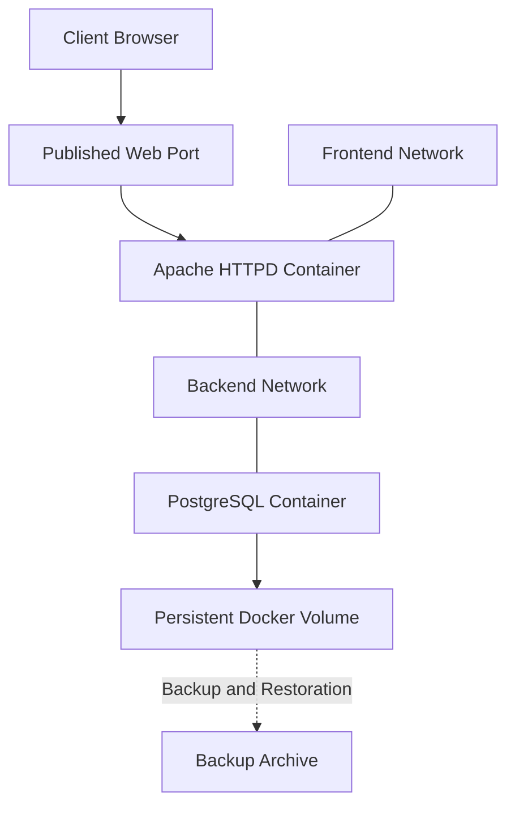

# Container Security Portfolio

Secure Container Deployment | Infrastructure Security | Docker | Linux

## 01. Portfolio Overview

This repository documents my practical development in container security, secure infrastructure deployment and system administration using Docker and Docker Compose.

The portfolio consists of six hands-on security lab projects designed around simulated campus service environments. Each project explores a specific aspect of container security, from secure deployment and network segmentation to privilege management, data persistence and disaster recovery.

The primary focus is understanding how security controls are implemented, verified and maintained throughout the container lifecycle.

## 02. Portfolio Objectives

- Design and deploy secure multi-container environments.
- Implement defence-in-depth security principles.
- Apply least-privilege container configurations.
- Reduce unnecessary service exposure.
- Implement frontend and backend network segmentation.
- Manage container resource consumption.
- Maintain persistent database storage.
- Perform database backup and restoration.
- Develop security verification and troubleshooting skills.
- Produce structured technical documentation.

## 03. Project Directory

| ID | Project | Application Scenario |
|---|---|---|
| 01 | Secure Multi-Container Deployment | Campus Helpdesk System |
| 02 | Container Resource Management | Campus Equipment Booking System |
| 03 | Container Network Segmentation | Campus Event Registration System |
| 04 | Container Security Hardening | Campus Student Services System |
| 05 | Persistent Storage and Data Integrity | Campus Library Loan System |
| 06 | Database Backup and Disaster Recovery | Campus Facility Maintenance System |

## 04. Project Descriptions

### Project 01 - Secure Multi-Container Deployment

Designing and deploying a controlled multi-container environment using Apache HTTPD, PostgreSQL and Docker Compose.

Technical focus:

- Multi-container architecture
- Docker Compose configuration
- Service deployment
- Container lifecycle management
- Restart policies
- Service functionality verification

### Project 02 - Container Resource Management

Implementing resource restrictions to control container resource consumption and support system stability.

Technical focus:

- CPU allocation
- Memory limitations
- Container resource monitoring
- Restart policies
- Resource isolation
- Service availability

### Project 03 - Container Network Segmentation

Designing segmented container networks to restrict unnecessary communication and reduce direct database exposure.

Technical focus:

- Custom Docker bridge networks
- Frontend and backend segmentation
- Container DNS resolution
- Internal service communication
- Database network isolation
- Network connectivity verification

### Project 04 - Container Security Hardening

Exploring least-privilege container configurations through Linux capability management and privilege restrictions.

Technical focus:

- Linux capabilities
- Capability removal using cap_drop
- Selective capability restoration using cap_add
- Privilege escalation prevention
- Non-privileged container execution
- Security configuration inspection
- Application functionality after hardening

### Project 05 - Persistent Storage and Data Integrity

Implementing persistent database storage and examining data availability throughout the container lifecycle.

Technical focus:

- Docker named volumes
- PostgreSQL persistent storage
- Container recreation
- Volume lifecycle management
- Database record verification
- Data integrity and persistence

### Project 06 - Database Backup and Disaster Recovery

Developing database backup and restoration procedures to support data availability and operational resilience.

Technical focus:

- PostgreSQL volume backup
- Database shutdown procedures
- Backup archive management
- Docker volume restoration
- Database recovery verification
- Disaster recovery procedures

## 05. Container Architecture

The lab environments use a segmented architecture consisting of an Apache HTTPD web container, a PostgreSQL database container, custom Docker networks and persistent storage.



Architecture characteristics:

- Separate frontend and backend networks.
- Web service connected to both networks.
- Database service connected only to the backend network.
- No directly published PostgreSQL port.
- Persistent database storage using named volumes.
- Resource restrictions for individual services.
- Container security controls based on least privilege.

The architecture demonstrates container infrastructure and network connectivity rather than a complete production application.

## 06. Security Controls

| Security Control | Implementation | Security Objective |
|---|---|---|
| Least Privilege | cap_drop | Remove unnecessary Linux capabilities |
| Capability Management | cap_add | Restore only necessary capabilities |
| Privilege Restrictions | no-new-privileges | Prevent additional privilege acquisition |
| Non-Privileged Execution | privileged: false | Avoid privileged container execution |
| Network Segmentation | Custom bridge networks | Restrict unnecessary network communication |
| Database Isolation | No published database port | Reduce direct database exposure |
| CPU Management | cpus | Restrict CPU consumption |
| Memory Management | mem_limit | Restrict memory consumption |
| Service Resilience | Restart policies | Support automatic service recovery |
| Persistent Storage | Named volumes | Preserve database records |
| Disaster Recovery | Backup and restoration | Support database recovery |

## 07. Security Principles

The portfolio explores the practical application of the following cybersecurity principles:

- Principle of Least Privilege
- Defence in Depth
- Attack Surface Reduction
- Network Segmentation
- Secure Configuration Management
- Resource Isolation
- Data Confidentiality
- Data Integrity
- Service Availability
- Operational Resilience

## 08. Technical Skills

| Domain | Technical Knowledge |
|---|---|
| Containerisation | Docker and Docker Compose |
| Infrastructure Security | Secure container configuration |
| Linux Security | Capability and privilege management |
| Network Security | Network segmentation and isolation |
| System Administration | Container lifecycle management |
| Resource Management | CPU and memory restrictions |
| Database Administration | PostgreSQL configuration |
| Storage Management | Docker persistent volumes |
| Disaster Recovery | Database backup and restoration |
| Configuration Management | YAML and environment variables |
| Security Verification | Docker inspection and testing |
| Version Control | Git and GitHub |
| Technical Documentation | Implementation and verification reports |

## 09. Tools and Technologies

| Technology | Purpose |
|---|---|
| Docker Desktop | Container deployment and management |
| Docker Compose | Multi-container configuration |
| Apache HTTPD | Web service hosting |
| PostgreSQL | Relational database management |
| Linux | Container operating environment |
| PowerShell | Command-line administration |
| YAML | Declarative infrastructure configuration |
| Git | Version control |
| GitHub | Portfolio and technical documentation |

## 10. Repository Structure

```text
container-security-portfolio/
|
|-- 01-secure-container-deployment/
|-- 02-container-resource-management/
|-- 03-network-segmentation/
|-- 04-container-hardening/
|-- 05-persistent-storage/
|-- 06-disaster-recovery/
|
|-- .gitignore
|-- README.md
```

Each project is intended to contain the following components:

```text
project-directory/
|
|-- README.md
|-- compose.yaml
|-- .env.example
|-- verification.md
|-- screenshots/
```

Project documentation includes deployment procedures, security configurations, verification evidence, troubleshooting observations and technical learning outcomes.

## 11. Implementation Methodology

Each project follows a structured implementation process.

1. Analyse technical and security requirements.
2. Design the container infrastructure.
3. Configure services using Docker Compose.
4. Implement appropriate security controls.
5. Deploy the container environment.
6. Verify service functionality.
7. Inspect security configurations.
8. Conduct controlled security tests.
9. Identify and troubleshoot configuration issues.
10. Document technical findings and limitations.

## 12. Security Verification Framework

Security verification is an essential component of each project.

| Verification Area | Verification Method |
|---|---|
| Container Deployment | Docker Compose status inspection |
| Service Availability | HTTP and PostgreSQL readiness testing |
| Resource Restrictions | Docker statistics and configuration inspection |
| Network Segmentation | Docker network inspection |
| Network Connectivity | Controlled container connectivity testing |
| Capability Restrictions | Container capability inspection |
| Privilege Restrictions | Security option inspection |
| Persistent Storage | Database records before and after recreation |
| Backup Integrity | Backup archive inspection |
| Disaster Recovery | Restored database record verification |

Actual test results, screenshots and technical observations are documented as each lab is completed.

## 13. Credential and Data Protection

Secure credential management is an important consideration throughout this portfolio.

The repository follows these intended practices:

- Separate credentials from published configuration files.
- Use environment variable templates.
- Exclude private environment files from version control.
- Avoid publishing real database passwords.
- Exclude sensitive database backups.
- Review screenshots for confidential information.
- Use fictional records for database testing.
- Keep original academic assessment materials private.

## 14. Technical Documentation Standards

Each project follows a consistent documentation structure.

- Project overview
- Security objectives
- Architecture design
- Deployment configuration
- Implementation procedures
- Security controls
- Verification commands
- Expected and actual results
- Supporting screenshots
- Troubleshooting procedures
- Technical limitations
- Learning outcomes

The objective is to demonstrate not only configuration knowledge but also the reasoning, testing and troubleshooting behind each security decision.


## 15. Project Status

| ID | Project | Status |
|---|---|---|
| 01 | Secure Multi-Container Deployment | Completed |
| 02 | Container Resource Management | Completed |
| 03 | Container Network Segmentation | Completed |
| 04 | Container Security Hardening | Completed |
| 05 | Persistent Storage and Data Integrity | Completed |
| 06 | Database Backup and Disaster Recovery | Completed |

### Portfolio Completion Summary

- Total Projects: 6
- Completed Projects: 6
- Projects In Progress: 0
- Completion Rate: 100%

### Technical Coverage

- [x] Secure multi-container deployment
- [x] Docker Compose configuration
- [x] CPU and memory resource management
- [x] Frontend and backend network segmentation
- [x] Linux capability management
- [x] Least-privilege container configuration
- [x] Privilege escalation prevention
- [x] PostgreSQL database configuration
- [x] Persistent volume management
- [x] Database backup and restoration

### Portfolio Outcome

The six container security lab projects represent practical learning across secure container deployment, infrastructure hardening, network isolation, resource management, persistent storage and disaster recovery.

The portfolio provides a foundation for further technical development in advanced container security, infrastructure protection and DevSecOps.


## 16. Future Development Roadmap

### Container Security

- [ ] Container vulnerability scanning using Trivy
- [ ] Container image analysis using Docker Scout
- [ ] Non-root container deployment
- [ ] Read-only container filesystems
- [ ] Docker secrets management
- [ ] Secure Dockerfile development
- [ ] Container image minimisation

### Infrastructure Security

- [ ] Container security monitoring
- [ ] Centralised logging
- [ ] Security configuration auditing
- [ ] Automated security verification
- [ ] Infrastructure hardening

### DevSecOps

- [ ] GitHub Actions
- [ ] Automated vulnerability scanning
- [ ] Software supply chain security
- [ ] Software Bill of Materials
- [ ] Secure CI/CD pipelines
- [ ] Kubernetes security fundamentals

## 17. Professional Development

I am a cybersecurity student developing practical technical skills in container security, infrastructure security, network security and Linux system administration.

My approach to cybersecurity emphasises understanding how systems operate, identifying unnecessary security exposure, implementing appropriate controls and verifying their effectiveness through controlled practical testing.

This portfolio represents my ongoing commitment to technical development, independent learning, security-focused problem-solving and professional documentation.

## 18. Project Background

The six projects are adapted from container security practical learning exercises.

Although the projects share a common Docker-based architecture, each lab emphasises a distinct security objective and verification process.

The portfolio is designed to demonstrate progressive technical development across container deployment, hardening, isolation, resource management, storage protection and disaster recovery.

## 19. Scope and Disclaimer

All projects are intended for educational purposes within authorised and controlled local lab environments.

The configurations demonstrate container security concepts and are not presented as fully hardened production systems.

Technical findings and implementation results are documented based on actual testing as the portfolio develops.

---

Container Security | Cybersecurity | Infrastructure Security | DevSecOps

Continuous Learning. Secure Implementation. Technical Verification.
